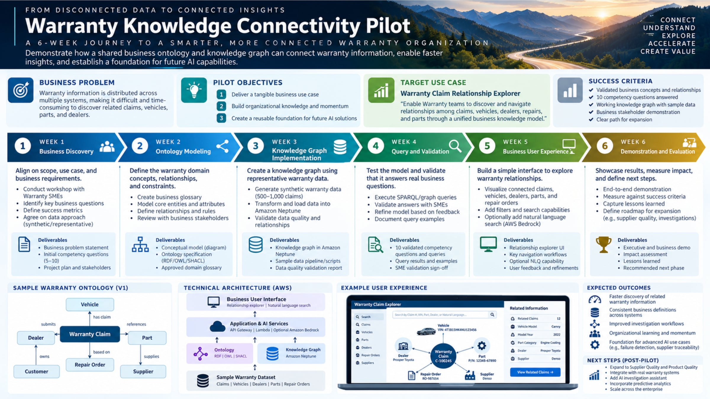
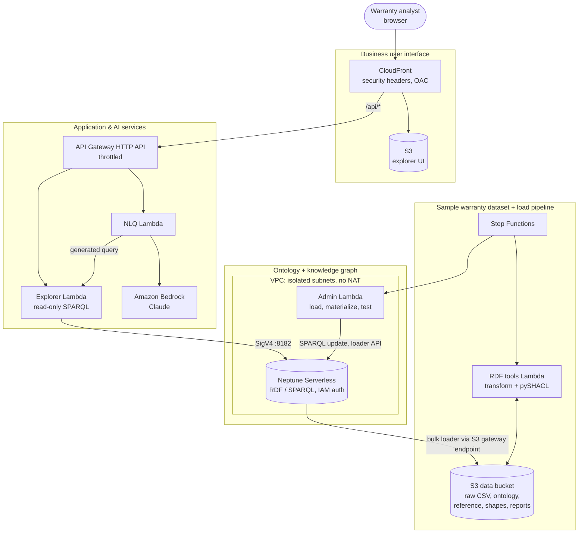
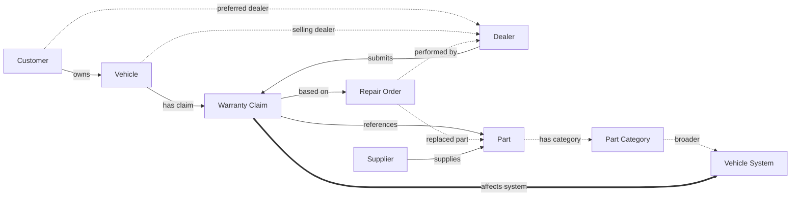
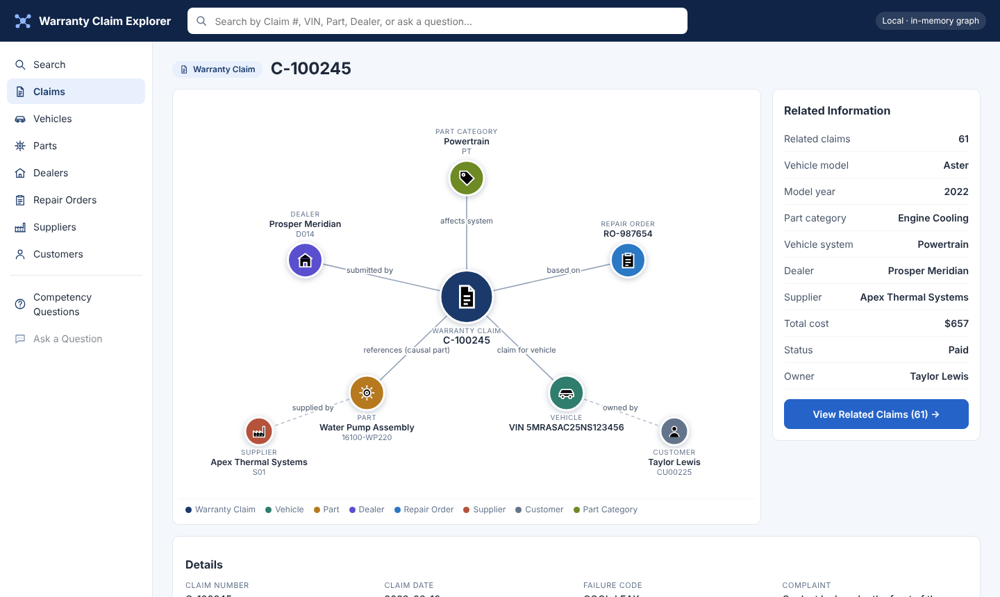
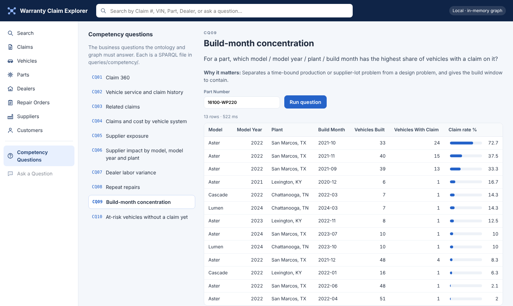

# Warranty Knowledge Connectivity Pilot

**From disconnected data to connected insights.** This repository builds the six-week pilot on
the infographic below, end to end and entirely with the **AWS CDK (Python)**: a shared warranty
business ontology (RDF/OWL/SHACL), a knowledge graph in **Amazon Neptune Serverless**, a
validated load pipeline, the ten competency questions as SPARQL, and the **Warranty Claim
Explorer** web app, with optional natural-language search on **Amazon Bedrock**.



> All data is synthetic. The OEM ("Meridian Motors"), its models, dealers, suppliers and
> customers are fictional; only city names are real.

**Contents:**
[What gets built](#what-gets-built) ·
[Architecture](#architecture) ·
[The ontology](#the-ontology) ·
[Competency questions](#the-ten-competency-questions) ·
[The explorer](#the-warranty-claim-explorer) ·
[Deploy](#deploy) ·
[Use it](#use-it) ·
[Run locally without AWS](#run-locally-without-aws) ·
[Data quality](#data-quality-shacl) ·
[The six weeks](#the-six-weeks-in-this-repository) ·
[Tests](#tests-and-ci) ·
[Security](#security) ·
[Cost and teardown](#cost-and-teardown) ·
[Troubleshooting](#troubleshooting) ·
[Layout](#project-layout)

## What gets built

Each element of the infographic, and where it lives in this repository:

| Infographic | Built here | Where |
|---|---|---|
| **Target use case:** Warranty Claim Relationship Explorer | Single-page web app on S3 + CloudFront: search, relationship graph, related-information panel, related claims, competency questions, natural-language search | [`frontend/`](frontend/), [`warranty_kg/explorer.py`](warranty_kg/explorer.py) |
| **Sample warranty ontology (v1)** | OWL ontology v1.1 (the v1 diagram plus the stakeholder-review refinements), SKOS part taxonomy, SHACL business rules | [`ontology/`](ontology/warranty.ttl), [`reference/`](reference/part-taxonomy.ttl), [`shapes/`](shapes/warranty-shapes.ttl) |
| **Sample warranty dataset** (claims, vehicles, dealers, parts, repair orders) | Deterministic generator: ~800 claims on 2,250 vehicles, with customers and suppliers too, plus three planted business signals | [`datagen/`](datagen/generate.py) |
| **Knowledge graph: Amazon Neptune** | Neptune Serverless (RDF / SPARQL 1.1), IAM auth, isolated VPC, four named graphs | [`infra/core_stack.py`](infra/core_stack.py) |
| **Application & AI services:** API Gateway, Lambda, optional Amazon Bedrock | HTTP API → read-only explorer Lambda; natural language → SPARQL Lambda on Bedrock | [`infra/app_stack.py`](infra/app_stack.py), [`functions/`](functions/) |
| **Week 3:** transform and load, validate data quality | Step Functions: CSV → RDF → SHACL validation → bulk load → materialize inferences → run the 10 questions | [`infra/core_stack.py`](infra/core_stack.py), [`warranty_kg/`](warranty_kg/) |
| **Week 4:** 10 validated competency questions and queries | One SPARQL file per question, runnable as-is, tested against the data | [`queries/competency/`](queries/competency/), [results](docs/competency-results.md) |
| **Deliverables for all six weeks** | Problem statement, glossary, model diagram, DQ report, sign-off templates, demo script, impact assessment, next-phase options | [`docs/pilot/`](docs/pilot/README.md) |

## Architecture

The four layers of the infographic's *Technical architecture (AWS)*, as deployed by
`cdk deploy --all`:



Three CDK stacks:

| Stack | Contents |
|---|---|
| `WarrantyKgCoreStack` | VPC (isolated subnets, S3 gateway endpoint, no NAT gateway), Neptune Serverless cluster and writer (`db.serverless`, IAM auth, encrypted), data bucket with the CSVs, ontology, reference data and shapes, loader role, admin and RDF-tools Lambdas, the Step Functions load pipeline, and a custom resource that starts the pipeline whenever the data or model changes |
| `WarrantyKgAppStack` | Explorer API Lambda (in the VPC, read-only IAM), NLQ Lambda (Bedrock), HTTP API with throttling, S3 site bucket, CloudFront distribution (`/*` → S3 with origin access control, `/api/*` → API), security headers including a strict Content-Security-Policy |
| `WarrantyKgNotebookStack` *(optional, `-c notebook=true`)* | Neptune workbench notebook with Graph Explorer and the `%%sparql` magic, for SME working sessions |

Why these choices:

- **RDF on Neptune, not a property graph.** The pilot calls for an ontology in RDF/OWL with SHACL
  rules and SPARQL queries. Neptune stores RDF natively and answers SPARQL 1.1, so the ontology,
  the reference data and the instance data live in one graph and are queried together.
- **Neptune doesn't reason over OWL or enforce SHACL, so the pipeline does both.** pySHACL validates
  every load before Neptune is touched, and [`warranty_kg/rules.py`](warranty_kg/rules.py)
  materializes the inferences the explorer needs (inverses, sub-properties, sub-classes,
  transitive taxonomy, derived `affectsSystem`) as SPARQL UPDATE into their own named graph.
- **Named graphs per source** (`ontology`, `reference`, `data`, `inferred`). Each can be reloaded
  or dropped on its own. Neptune's default graph is the union, so queries see everything.
- **Bedrock outside the VPC.** The NLQ function runs outside the VPC (no NAT gateway or Bedrock
  interface endpoint needed) and never talks to Neptune itself: generated queries run through the
  read-only explorer function, which checks them again.

## The ontology

Version 1.1 of the infographic's sample ontology. The seven entities and relationships of v1 are
kept; the Week 2 review added what the competency questions need
([full change log and glossary](docs/pilot/week-2-ontology-modeling.md)).



| File | What it holds |
|---|---|
| [`ontology/warranty.ttl`](ontology/warranty.ttl) | 12 classes (with a `BusinessEntity` › `Party` › `Organization` hierarchy), 23 relationships (most with `owl:inverseOf` pairs), 39 attributes, every one labeled |
| [`reference/part-taxonomy.ttl`](reference/part-taxonomy.ttl) | SKOS part taxonomy: 5 vehicle systems and 14 part categories, and the claim status list |
| [`shapes/warranty-shapes.ttl`](shapes/warranty-shapes.ttl) | SHACL rules: identifier formats, cardinalities, value ranges, and cross-entity checks in SHACL-SPARQL (total = labor + parts, claim not before in-service, claim and RO agree on dealer and vehicle) |

The Neptune graph after a load (seed 42): 71,024 data triples, 483 ontology and reference triples,
and 26,308 inferred triples.

## The ten competency questions

The pilot's acceptance tests: the questions the graph must answer. Each is a SPARQL file in
[`queries/competency/`](queries/competency/), runs in the explorer and the CLI, and runs after
every load. [Full results on the synthetic data](docs/competency-results.md).

| # | Question | What the synthetic data shows |
|---|---|---|
| CQ01 | For a claim, which vehicle, owner, dealer, repair order, causal part, supplier and system are involved? | C-100245 → Aster, Prosper Meridian, RO-987654, water pump, Apex Thermal Systems, Powertrain |
| CQ02 | What is a vehicle's full repair and claim history? | One timeline across dealers and pay types |
| CQ03 | Which other claims name the same causal part on the same model, and when were those vehicles built? | 61 related claims, clustered in San Marcos late-2021 builds |
| CQ04 | Claims and cost by vehicle system and part category | Roll-up through the SKOS taxonomy |
| CQ05 | Which suppliers' parts drive the most claims and cost? | Supplier exposure ranking |
| CQ06 | For a supplier: which parts, models, years and plants, how early in service? | Water pump on Aster MY2022 San Marcos: 59 claims at ~15 months in service |
| CQ07 | Which dealers book more labor than standard? | Tyler Meridian at 1.62× standard; everyone else ≤ 1.1× |
| CQ08 | Which vehicles came back for the same problem within 3 months? | 14 repeat repairs, nearly all at Tyler Meridian |
| CQ09 | Which build month has the highest share of vehicles with a claim on a part? | October 2021 at San Marcos: 73% |
| CQ10 | Which vehicles in the suspect window haven't failed yet, and who owns them? | 75 vehicles, with owners and servicing dealers |

## The Warranty Claim Explorer



Modeled on the infographic's *Example user experience*: search by claim number, VIN, part,
dealer or a question; the claim at the center with its vehicle, dealer, repair order and part,
and one hop further to the supplier and the owner; **Related Information** and **View Related
Claims**. Click any node to re-center on it. The left navigation lists every entity type, and
**Competency Questions** runs the ten questions with editable parameters:



[Workflows and design notes](docs/pilot/week-5-user-experience.md).

## Deploy

**Prerequisites:** an AWS account and credentials, Python 3.11+, Node.js 18+, the CDK CLI
(`npm install -g aws-cdk`). Internet access at synth time (pip downloads rdflib and pySHACL for
the RDF-tools Lambda; no Docker needed). For natural-language search, access to an Anthropic
Claude model in Amazon Bedrock.

```bash
git clone https://github.com/mickemora/warranty-knowledge-graph && cd warranty-knowledge-graph
python -m venv .venv && source .venv/bin/activate
pip install -r requirements-dev.txt

cdk bootstrap            # once per account and region
cdk deploy --all         # about 20 minutes, mostly the Neptune cluster
```

The first synth generates the dataset (`data/generated/`) and builds the Lambda bundles
(`build/lambda/`). The deploy uploads the data, ontology, reference data and shapes to S3, and
then **starts the load pipeline automatically**. It takes a few minutes after the deploy
finishes; follow it with `python scripts/kg.py status`, or in the Step Functions console.

When it shows `SUCCEEDED`, open the explorer:

```bash
python scripts/kg.py url
```

Options (`cdk deploy --all -c key=value`):

| Context key | Default | Effect |
|---|---|---|
| `nlq` | `true` | Natural-language search with Amazon Bedrock (`false` to leave it out) |
| `nlqModelId` | `global.anthropic.claude-sonnet-5` | Any Bedrock model ID or inference profile that supports the Converse API |
| `notebook` | `false` | Neptune workbench notebook with Graph Explorer (ml.t3.medium, billed while running) |
| `autoLoad` | `true` | Run the pipeline on deploys that change the data, ontology, shapes or mapping code |
| `minNcu` / `maxNcu` | `1` / `8` | Neptune Serverless capacity range |
| `neptuneEngineVersion` | `1.4.7.1` | Neptune engine version (Serverless needs 1.2.0.1 or later) |

If Bedrock answers "access denied" the first time, open the Bedrock console's model catalog and
complete Anthropic's first-use form, or pick another model with `-c nlqModelId=...`.

## Use it

```bash
python scripts/kg.py url                     # explorer URL (CloudFront)
python scripts/kg.py pipeline                # rerun transform -> validate -> load -> materialize -> test
python scripts/kg.py status                  # recent pipeline runs
python scripts/kg.py report                  # latest SHACL data-quality report
python scripts/kg.py cq list                 # the ten competency questions
python scripts/kg.py cq run cq09
python scripts/kg.py cq run cq10 --param buildFrom=2021-10-01 --param buildTo=2021-10-31
python scripts/kg.py sparql "SELECT ?system (COUNT(?c) AS ?n) WHERE { ?c <https://warranty.example.com/ontology#affectsSystem>/<http://www.w3.org/2000/01/rdf-schema#label> ?system } GROUP BY ?system"
python scripts/kg.py nlq "Which dealers submitted the most water pump claims?"
python scripts/kg.py diagnose                # Neptune reachability, load jobs, triples per graph
```

`sparql` runs through the admin function with a read-only guard; `nlq` calls the deployed NLQ
function. Every command uses your AWS credentials and finds resources from the stack outputs.

**Change the model or the data, then redeploy.** Edit `ontology/`, `reference/`, `shapes/`,
`warranty_kg/mapping.py` or regenerate the data (`python -m datagen.generate --seed 7`), run
`pytest`, then `cdk deploy --all`: the pipeline reruns because the source hash changed.

**Graph Explorer and notebooks.** Deploy with `-c notebook=true`, then in the Neptune console open
**Notebooks → aws-neptune-warranty-kg → Open Graph Explorer** (connect with SPARQL), or
**Open JupyterLab** and paste any file from `queries/competency/` under a `%%sparql` cell.

## Run locally without AWS

The same mapping, rules, API code and UI run against an in-memory copy of the graph (rdflib):

```bash
pip install -r requirements-dev.txt
python scripts/serve_local.py                # http://localhost:8765
python scripts/serve_local.py --bedrock      # plus natural-language search (AWS credentials needed)

python scripts/kg.py cq run cq09 --local
python scripts/kg.py sparql --local "SELECT (COUNT(*) AS ?n) WHERE { ?s ?p ?o }"
python scripts/kg.py cq report --local       # regenerates docs/competency-results.md
```

Useful for SME workshops before anything is deployed, and for UI and query work.

## Data quality (SHACL)

Every load is validated before it reaches Neptune. On the clean dataset the report shows
0 violations and 2 warnings (claims over 8 labor hours at the high-labor dealer). To see the
rules catch real problems:

```bash
python -m datagen.generate --inject-defects --out /tmp/wkg-defects
python scripts/kg.py validate --local --raw /tmp/wkg-defects/raw
```

All eight injected defects are reported: claim before in-service, total ≠ labor + parts,
negative cost, claim dealer ≠ RO dealer, missing causal part, 55 labor hours, malformed claim
number, VIN containing an "O". In AWS, the same data stops the pipeline at
*Data quality check failed* and nothing is loaded; `kg.py report` lists the violations.
[Details](docs/pilot/week-3-knowledge-graph.md#data-quality-validation-report).

## The six weeks in this repository

| Week | Deliverables (infographic) | Here |
|---|---|---|
| 1 · Business discovery | Problem statement · initial competency questions · project plan and stakeholders | [week-1](docs/pilot/week-1-business-discovery.md) |
| 2 · Ontology modeling | Conceptual model · ontology specification (RDF/OWL/SHACL) · approved glossary | [week-2](docs/pilot/week-2-ontology-modeling.md), `ontology/`, `reference/`, `shapes/` |
| 3 · Knowledge graph implementation | Graph in Neptune · data pipeline/scripts · data quality report | [week-3](docs/pilot/week-3-knowledge-graph.md), `datagen/`, `warranty_kg/`, core stack |
| 4 · Query and validation | 10 validated questions and queries · results and examples · SME sign-off | [week-4](docs/pilot/week-4-query-validation.md), `queries/competency/`, [results](docs/competency-results.md) |
| 5 · Business user experience | Relationship explorer UI · navigation workflows · optional NLQ · feedback | [week-5](docs/pilot/week-5-user-experience.md), `frontend/`, app stack |
| 6 · Demonstration and evaluation | Demo · impact assessment · lessons learned · next phase | [week-6](docs/pilot/week-6-demo-and-evaluation.md) |

**Success criteria → evidence:** validated concepts (Week 2 sign-off) · 10 competency questions
answered (the pipeline's smoke test and the Week 4 sign-off) · working graph with sample data
(a `SUCCEEDED` pipeline run) · stakeholder demonstration (Week 6 demo script) · clear path for
expansion (Week 6 next-phase options: supplier and product quality, real data integration, an AI
investigation assistant, predictive analytics).

## Tests and CI

```bash
pytest -q
```

| Test file | Covers |
|---|---|
| `test_datagen.py` | Volumes, VIN check digits, referential integrity, the planted signals, defect injection |
| `test_ontology.py` | Ontology and taxonomy structure, documentation, vocabulary use; clean data conforms; all eight injected defects are caught |
| `test_rules_and_competency.py` | Each materialization rule; idempotence; all ten competency answers, including the expected business findings; parameter injection is rejected |
| `test_explorer.py` | Search, lists, entity, neighborhood (mockup parity), related panel, HTTP routing and errors |
| `test_guards_and_nlq.py` | The read-only SPARQL guard; result conversion; the NLQ flow with Bedrock stubbed (success, and a rejected update after one retry) |
| `test_lambdas.py` | Admin (load, status, materialize, smoke test) with Neptune faked; transform + validate with S3 faked |
| `test_stacks.py` | CDK templates: Neptune Serverless, pipeline states, functions, least-privilege IAM, API routes and throttling, CloudFront, notebook |

CI ([`.github/workflows/ci.yml`](.github/workflows/ci.yml)) runs the tests, requires the CDK tests
to run rather than skip, runs `cdk synth --all`, checks the Lambda bundles, and smoke-tests the
local explorer.

## Security

- Neptune is in isolated subnets with no internet route, IAM database authentication and
  encryption at rest. Only the admin and explorer functions' security group can reach port 8182.
- Least privilege: the explorer function has `neptune-db:ReadDataViaQuery` only; only the admin
  function can write or start bulk loads. The NLQ function can invoke Bedrock and the explorer
  function, and nothing else.
- Queries from outside the code (NLQ, CLI) pass a read-only guard (no updates, no `SERVICE`
  federation, row limit) and are sent as `query=`, which Neptune never executes as an update.
  Competency-question parameters are validated against a pattern before they're bound.
- The explorer is served only over HTTPS with a strict Content-Security-Policy (no inline or
  third-party scripts), frame denial and HSTS. The HTTP API is throttled.
- **The explorer has no sign-in.** That's acceptable for synthetic data. Before loading real
  warranty data, add authentication (for example Amazon Cognito with an API Gateway JWT
  authorizer, or IAM Identity Center via an Application Load Balancer) and AWS WAF.

## Cost and teardown

Neptune Serverless never scales below its minimum capacity (1 NCU by default), so the cluster
bills for every hour it exists, even when idle. The rest (Lambda, API Gateway, Step Functions,
CloudFront, S3, Bedrock) is pay-per-use and small at pilot volumes. The optional notebook bills
while it is running. See [Neptune pricing](https://aws.amazon.com/neptune/pricing/).

```bash
cdk destroy --all
```

Removes everything, including the buckets and their objects, with no final Neptune snapshot.
Because the deploy reloads the graph automatically, destroying between demos and redeploying is
cheap in effort.

## Troubleshooting

- **The explorer shows errors right after deploy.** The graph is still loading: `kg.py status`.
- **Pipeline stopped at "Data quality check failed."** `kg.py report` lists each violation and
  example records; nothing was loaded.
- **Pipeline stopped at "Bulk load failed," or queries hang.** `kg.py diagnose` shows whether the
  function reaches Neptune, recent loader jobs with errors, and triples per graph.
- **Engine version not offered in your region.**
  `aws neptune describe-db-engine-versions --engine neptune --query "DBEngineVersions[].EngineVersion"`,
  then `cdk deploy --all -c neptuneEngineVersion=<version>`.
- **Natural-language search returns an access error.** Enable the model in Bedrock, or set
  `-c nlqModelId=` to a model your account can use. `-c nlq=false` removes the feature.
- **Synth fails installing rdflib/pySHACL.** Synth needs PyPI access the first time;
  `python scripts/build_assets.py` reproduces the step on its own.

## Simplifications

- Synthetic data with one OEM; no recalls, TSBs, labor operation codes or supplier lots yet.
- Months in service is computed at load time; claims don't track coverage type explicitly.
- The materialization rules are a deliberate subset of RDFS/OWL 2 RL, not a general reasoner.
- Search is substring matching over keys and names. At production scale, add Neptune full-text
  search (OpenSearch integration).

## Project layout

```
app.py                         CDK app: generates data, builds Lambda bundles, defines the stacks
infra/core_stack.py            VPC, Neptune Serverless, data bucket, Lambdas, Step Functions pipeline
infra/app_stack.py             Explorer API, NLQ (Bedrock), HTTP API, S3 + CloudFront site
infra/notebook_stack.py        Optional Neptune workbench notebook with Graph Explorer
ontology/warranty.ttl          The warranty ontology (OWL)
reference/part-taxonomy.ttl    Part taxonomy and claim statuses (SKOS)
shapes/warranty-shapes.ttl     Business rules (SHACL)
queries/competency/            The ten competency questions (SPARQL)
datagen/                       Synthetic warranty data generator
warranty_kg/                   Shared library: IRIs, mapping, validation, rules, SPARQL clients,
                               competency runner, explorer API logic, NLQ
functions/                     Lambda handlers: admin, rdf_tools, explorer_api, nlq
frontend/                      Warranty Claim Explorer (HTML, CSS, JS; no dependencies)
scripts/kg.py                  CLI
scripts/serve_local.py         Local explorer on an in-memory graph
scripts/build_assets.py        Builds the Lambda bundles (no Docker)
docs/pilot/                    Week-by-week pilot deliverables
docs/competency-results.md     Competency question results on the synthetic data
tests/                         pytest suite
```
