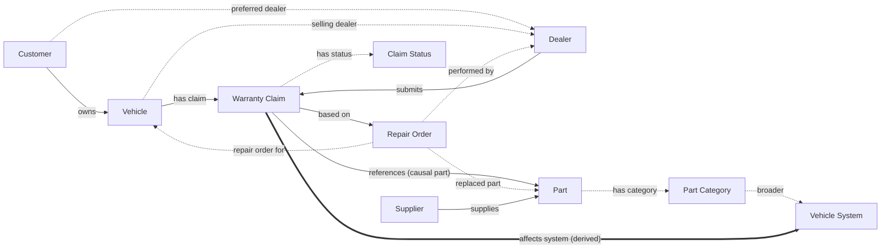

# Week 2: Ontology modeling

**Goal:** define the warranty domain's concepts, relationships and constraints, and review them
with the business.

Artifacts:

| Artifact | File | Standard |
|---|---|---|
| Ontology specification | [`ontology/warranty.ttl`](../../ontology/warranty.ttl) | RDF, RDFS, OWL 2 |
| Part taxonomy and claim statuses (reference data) | [`reference/part-taxonomy.ttl`](../../reference/part-taxonomy.ttl) | SKOS |
| Business rules | [`shapes/warranty-shapes.ttl`](../../shapes/warranty-shapes.ttl) | SHACL, SHACL-SPARQL |
| Conceptual model, glossary | this page | |

The split is deliberate: the **ontology** says what things mean, the **taxonomy** is reference data
business users can extend without an ontology change, and the **shapes** say what a valid record
looks like.

## Conceptual model (v1.1)

Solid lines are the seven relationships on the v1 diagram. Dotted lines were added in the
stakeholder review. The thick line is derived by the materialization rules, not loaded.

Class hierarchy: `Dealer` and `Supplier` are `Organization`s; `Organization` and `Customer` are
`Party`s; every business record is a `BusinessEntity`. `PartCategory` and `ClaimStatus` are
`skos:Concept`s.

## Changes from the v1 diagram (stakeholder review)

| Change | Why |
|---|---|
| **owns** now links Customer → Vehicle (v1 drew it between Customer and Dealer) | A customer owns a vehicle. The customer–dealer link is a different fact: their preferred (servicing) dealer, added as **preferredDealer**. |
| Added **repairOrderFor**, **performedBy**, **replacedPart** on Repair Order | Needed for vehicle history (CQ02) and to check that a claim's dealer and vehicle match its repair order. |
| Added **sellingDealer** on Vehicle | Distinguishes the selling dealer from the dealer that repaired the vehicle. |
| Added **Part Category** (SKOS taxonomy, two levels) | Roll-up by vehicle system (CQ04) without a hand-maintained mapping table. |
| Added **Claim Status** as a controlled list | Free-text statuses could not be compared across systems. |
| Added **standardLaborHours** (Part) and **monthsInService** (Claim) | Dealer labor variance (CQ07) and time-to-failure (CQ06, CQ08). |
| Every relationship has a named **inverse** | Navigation works in both directions in the explorer (a vehicle's claims as well as a claim's vehicle). |
| Every business key is a sub-property of **identifier** | One property to search, whichever key the user types. |

## Business glossary

| Term | Definition | Ontology term | Example |
|---|---|---|---|
| Warranty claim | A dealer's request to the manufacturer for reimbursement of a repair performed under warranty on a specific vehicle | `wko:WarrantyClaim` | C-100245 |
| Vehicle | A single built and sold vehicle, identified by its 17-character VIN | `wko:Vehicle` | 5MRASAC25NS123456 |
| Dealer | An authorized retailer that sells and services vehicles and submits claims | `wko:Dealer` | D014 Prosper Meridian |
| Customer | The registered owner of a vehicle | `wko:Customer` | CU00225 |
| Repair order (RO) | The dealer's work record for one service visit | `wko:RepairOrder` | RO-987654 |
| Part | A serviceable component identified by a part number | `wko:Part` | 16100-WP220 Water Pump Assembly |
| Causal part | The part judged responsible for the failure on a claim | `wko:referencesPart` | |
| Supplier | A company that manufactures and supplies parts | `wko:Supplier` | S01 Apex Thermal Systems |
| Part category / vehicle system | A node in the part taxonomy; the top level is the vehicle system | `wko:PartCategory`, `skos:broader` | Engine Cooling → Powertrain |
| Complaint / cause / correction | The "three Cs" on a claim: what the customer reported, what was wrong, what was done | `wko:complaint`, `wko:cause`, `wko:correction` | |
| Failure code | Coded failure mode | `wko:failureCode` | COOL-LEAK |
| In-service date | Delivery to the first retail customer; the warranty clock starts here | `wko:inServiceDate` | |
| Months in service (MIS) | Whole months from in-service date to claim date | `wko:monthsInService` | 14 |
| Standard labor hours | The labor time the OEM pays for replacing a part | `wko:standardLaborHours` | 2.6 |
| Pay type | Warranty or CustomerPay; only Warranty ROs support claims | `wko:payType` | Warranty |
| Build window | A range of build dates at one plant, used to scope a containment or field action | (query parameter, CQ09/CQ10) | 2021-09-01 to 2021-12-15 |
| Repeat repair (comeback) | Another claim in the same part category on the same vehicle within 3 months | (CQ08) | |

## Business rules (SHACL)

Violations stop the load; warnings are reported only.

| Rule | Severity |
|---|---|
| Claim number, VIN, dealer code, part number, RO number, customer ID and supplier code follow their formats (VIN: 17 characters, no I/O/Q) | Violation |
| A claim has exactly one vehicle, dealer, repair order, causal part and status, and they exist | Violation |
| Total cost = labor cost + parts cost; no negative costs; labor hours 0–40; mileage 0–60,000 | Violation |
| A claim's date is not before its vehicle's in-service date | Violation |
| A claim's dealer and vehicle match its repair order, and that RO's pay type is Warranty | Violation |
| A vehicle has a registered owner; build date before in-service date; model year 2015–2027 | Violation |
| A part has exactly one supplier and one category; positive unit cost and standard labor hours | Violation |
| RO open date not after close date; pay type is Warranty or CustomerPay | Violation |
| More than 8 labor hours on one claim | Warning |
| Missing cause on a claim | Warning |

## Stakeholder review checklist

- [ ] Every glossary term has an SME-approved definition
- [ ] The relationships answer all ten competency questions (trace each CQ to the properties it uses)
- [ ] Identifiers match what users type today (claim, VIN, part, dealer, RO formats)
- [ ] The part taxonomy matches how warranty reports roll up cost
- [ ] Business rules (above) reflect real claim policy; severities agreed
- [ ] Open questions logged for the next phase (for example: labor operation codes, TSBs, recalls)
