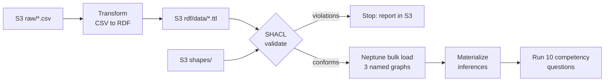

# Week 3: Knowledge graph implementation

**Goal:** build the knowledge graph in Amazon Neptune from representative warranty data.

## Representative data

`python -m datagen.generate` writes the CSV extracts a warranty system would export
(`data/generated/raw/`), deterministic for a given seed:

| Table | Rows (seed 42) |
|---|---|
| claims | 789 |
| vehicles | 2,250 |
| repair_orders | 1,309 (every claim's RO plus customer-pay visits) |
| customers | 2,082 |
| parts | 29 |
| dealers | 24 |
| suppliers | 11 |

Three business signals are planted so the competency questions find something real:

1. **Supplier / build-window defect.** Apex Thermal Systems water pumps (16100-WP220) on
   Aster MY2022 vehicles built at San Marcos, TX between 2021-09-01 and 2021-12-15 fail at many
   times the baseline rate.
2. **Repeat repairs and high labor at one dealer.** Vehicles serviced at Tyler Meridian (D017)
   come back within weeks with a second claim on the same part, and the dealer books about 1.6×
   the standard labor time.
3. **The showcase claim** from the infographic's mockup: C-100245, a water pump on an Aster at
   Prosper Meridian, based on RO-987654.

## Pipeline



An AWS Step Functions state machine runs it on every `cdk deploy` that changes the data,
ontology, shapes or mapping code, and on demand (`python scripts/kg.py pipeline`).

| Step | Code | What it does |
|---|---|---|
| Transform | `warranty_kg/mapping.py` in the rdf-tools Lambda | One CSV column → one ontology property. Derives months in service. Checks VIN check digits. Leaves bad values for validation to report. |
| Validate | `warranty_kg/validation.py` (pySHACL) | Validates data + reference data against the shapes and checks every term is declared in the ontology. Writes `reports/shacl/<time>.ttl` and `reports/latest.json`. Violations stop the pipeline before Neptune is touched. |
| Load | `functions/admin` → Neptune loader | Drops the named graphs, then bulk-loads `ontology/`, `reference/` and `rdf/data/` (Turtle) into their own named graphs. |
| Materialize | `warranty_kg/rules.py` | Inverses, sub-properties, sub-classes, transitive taxonomy and the derived `affectsSystem`, written to the `inferred` graph. |
| Smoke test | `queries/competency/` | Runs all ten competency questions; any empty answer fails the run. |

Named graphs (Neptune's default graph is the union, so queries see all of them):

| Graph | Contents | Triples (seed 42) |
|---|---|---|
| `…/graph/ontology` | `ontology/warranty.ttl` | 335 |
| `…/graph/reference` | part taxonomy, claim statuses | 148 |
| `…/graph/data` | transformed warranty records | 71,024 |
| `…/graph/inferred` | materialized inferences | 26,308 |

## Data quality validation report

On the clean dataset: **0 violations, 2 warnings** (two claims at the high-labor dealer above
8 labor hours).

To see the shapes catch problems, generate a dataset with eight known defects and validate it:

```bash
python -m datagen.generate --inject-defects --out /tmp/wkg-defects
python scripts/kg.py validate --local --raw /tmp/wkg-defects/raw --report /tmp/shacl-report.ttl
```

| Injected defect | Caught by |
|---|---|
| Claim dated before the vehicle's in-service date | SHACL-SPARQL claim-date rule, and months-in-service range |
| Total ≠ labor + parts | SHACL-SPARQL total-cost rule |
| Negative parts cost | `sh:minInclusive 0` |
| Claim dealer ≠ RO dealer | SHACL-SPARQL dealer-match rule |
| Missing causal part | `sh:minCount 1` on `referencesPart` |
| 55 labor hours | `sh:maxInclusive 40` |
| Malformed claim number | `sh:pattern` |
| VIN containing the letter O | `sh:pattern` on `vin` |

To run the same in AWS: upload the defective CSVs to the bucket's `raw/` prefix and run
`python scripts/kg.py pipeline`. The run stops at "Data quality check failed";
`python scripts/kg.py report` prints the violations.
